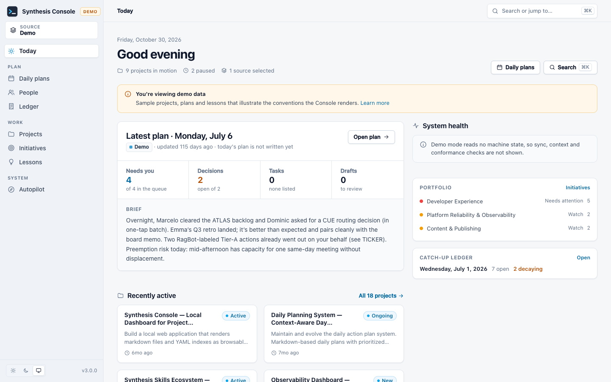
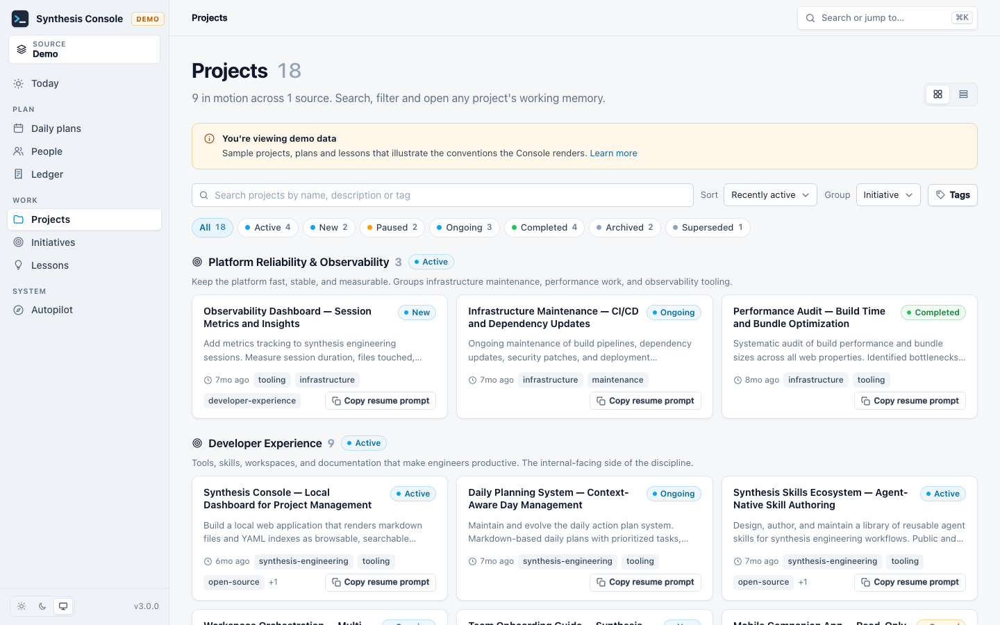
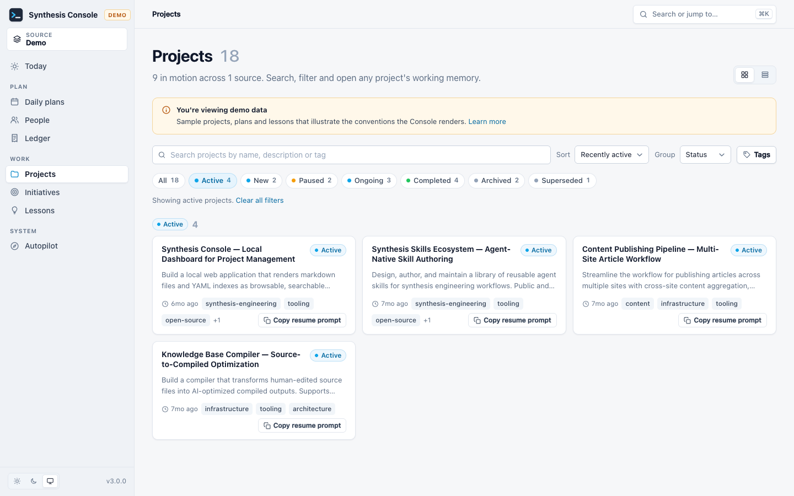
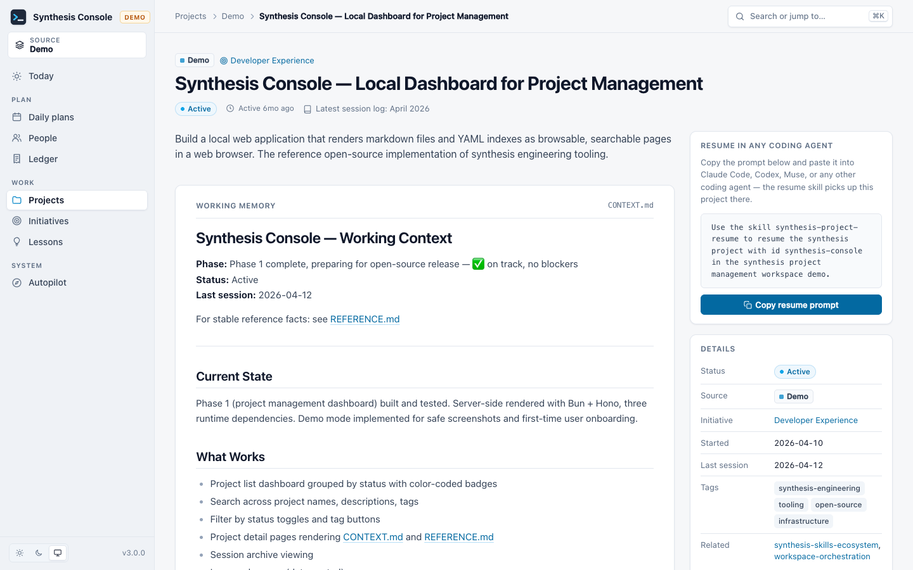
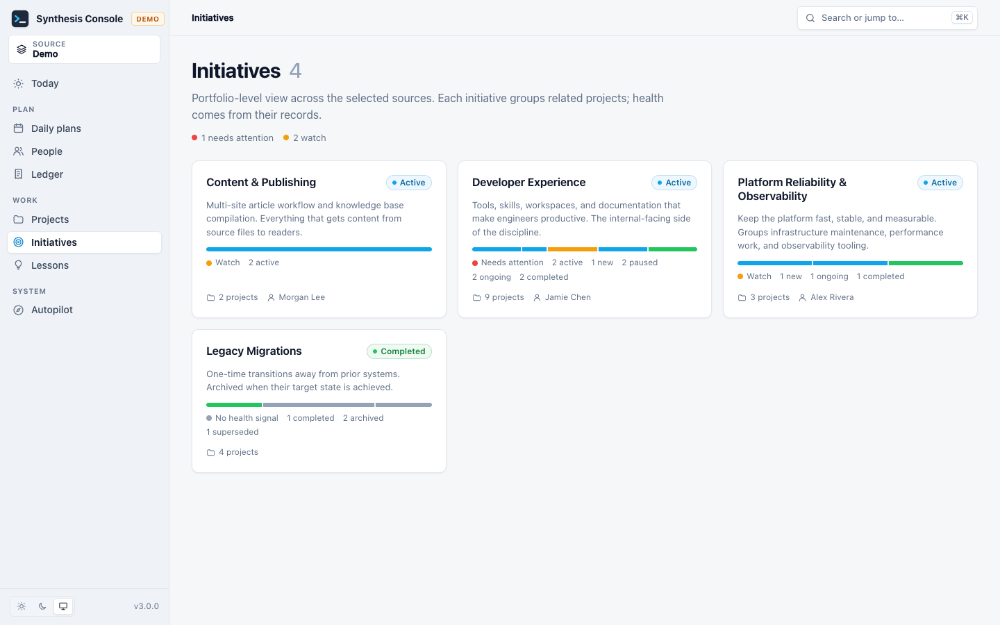
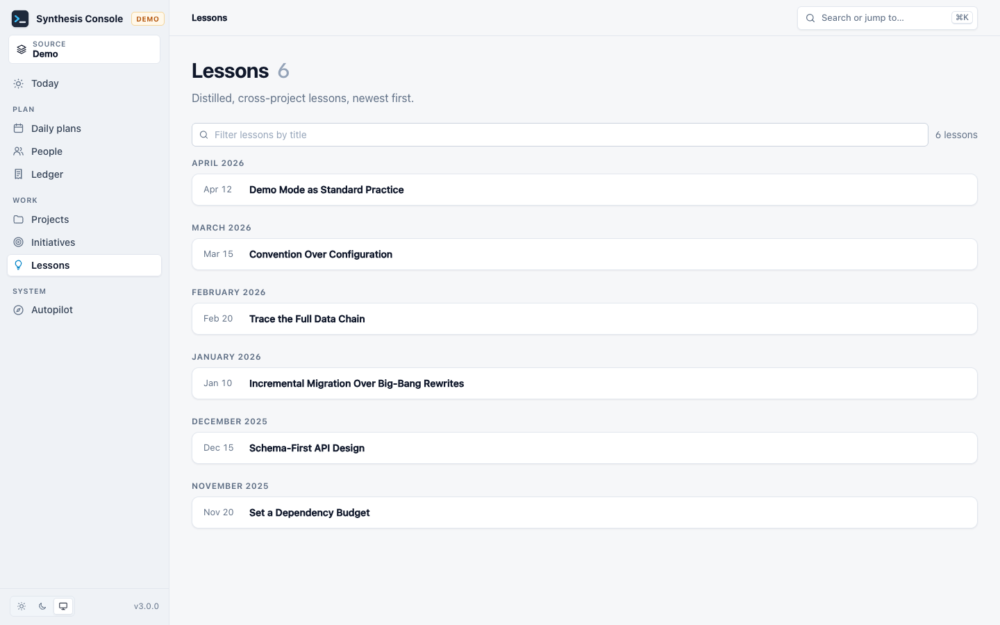
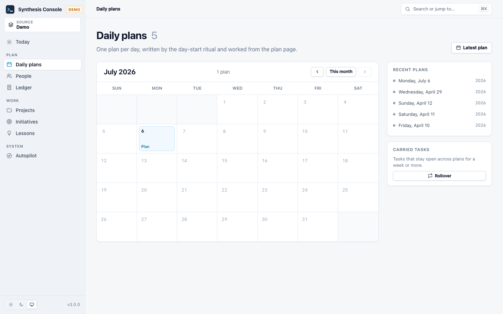
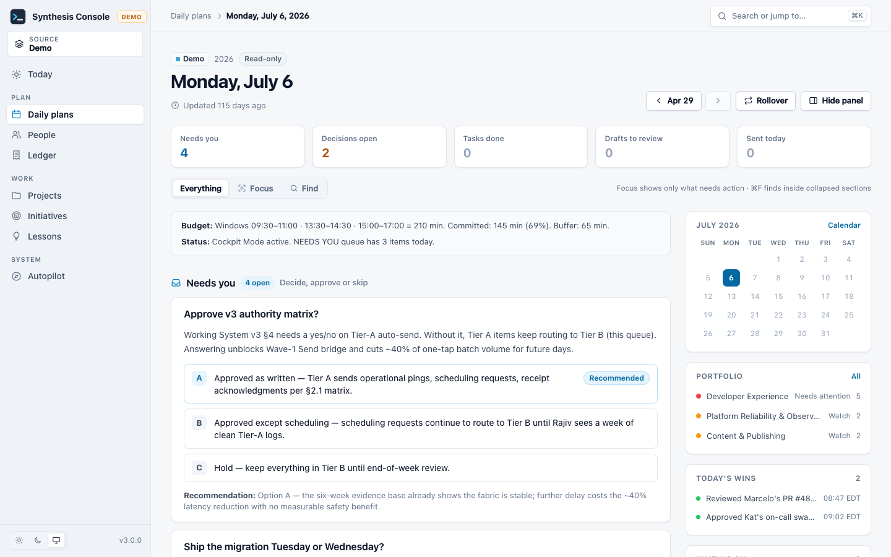
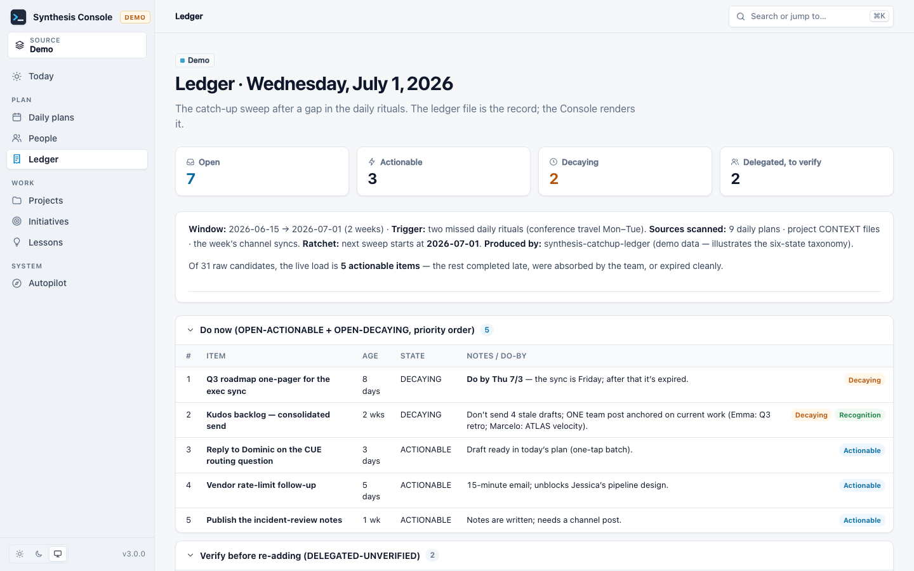
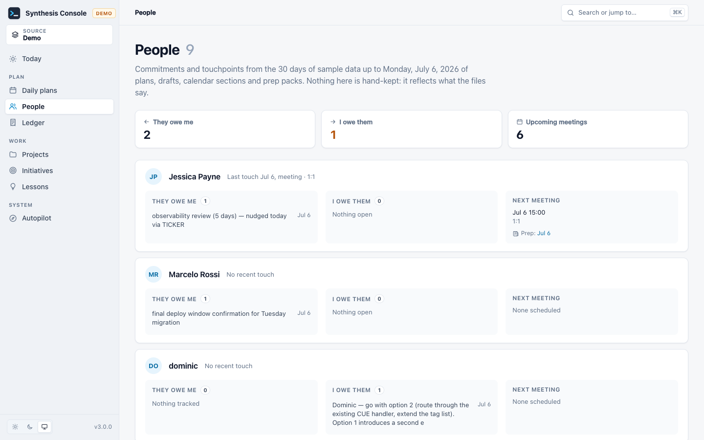

# Synthesis Console

Local-first, open-source tooling for synthesis engineering. Renders your project management YAML and markdown files as browsable, searchable pages in a web browser.

**Website:** [ragenie.ai/synthesis-console](https://ragenie.ai/synthesis-console/)

Read the origin story: [Synthesis Console: open-source tooling for synthesis engineering](https://synthesiscoding.org/blog/2026/04/12/synthesis-console-open-source-tooling-for-synthesis-engineering/)



## What Is This?

If you practice synthesis engineering — managing projects through structured markdown and YAML conventions — you accumulate files: project indexes, working context documents, reference files, session archives, lessons learned. These files are the working memory of your practice. But browsing them means reading raw files in a text editor or asking your AI agent to parse them.

Synthesis Console renders those files as a browsable console. Project list with status badges and tag filtering. Project detail with rendered markdown. Session history. Lessons learned. All from the files you already have, with no import step and no database.

Synthesis engineering is a discipline for structured human-AI collaboration — like agile or Scrum, but for AI-native workflows. This console is one open-source implementation of the tooling layer. Others can build their own.

## What 3.0 changes

3.0 rebuilds the interface. The data model, URLs and API routes stay the same; every view now sits on one design system.

- **Navigation.** A left sidebar groups the views: Today; Plan (daily plans, people, ledger); Work (projects, initiatives, lessons, conversations); System (autopilot, context, conformance, sync). Each System item carries a live status dot, with a count when something needs a look. Under 960 px wide the sidebar becomes a drawer.
- **Today** (`/`). What needs you now: today's plan with its queue, decisions, tasks and drafts; system health; the projects most recently in motion; portfolio health; autopilot runs; recent conversations. Until the day-start ritual writes today's plan, the latest plan stands in, labeled as such.
- **Command palette.** Cmd-K or `/` jumps to any section, project, initiative, lesson or recent plan, and searches projects, lessons and conversations. It reads `/api/palette`, which covers only the active sources.
- **Light and dark themes** from one token set. The Console follows the system setting; a switch in the sidebar overrides it.
- **Projects.** One toolbar line for search, sort, grouping, source and tags; status chips with counts; cards or a dense list, remembered per browser.
- **Plan page.** One main column in working order (needs you, brief, today, must do, this week, drafts, prep packs, on your behalf, more) beside a context rail (calendar, portfolio, wins, waiting on, ledger). Every action stays: approve, edit, skip, send, copy, done. A recorded decision can be changed (`POST /plans/:source/:date/decision/:index/undo`). Field lines in plans and project records (`**Status:** …` followed by `**Mode:** …`) keep their own lines.
- **Accessibility.** A skip link, named landmarks, visible focus rings, and status that always carries a word as well as a color. The browser test checks a laptop viewport and a phone viewport.

The Console still makes no third-party requests: the stylesheet, the client script and the icons ship with it, and the vendored classless CSS framework is gone.

## Synthesis v5 views

Five views read the synthesis v5 system on this machine. v5 is installed by the
[synthesis-skills](https://github.com/synthesisengineering/synthesis-skills)
plugin in each harness (Claude Code, Codex, Muse); its runtime lives in
`SYNTHESIS_HOME` (default `~/.synthesis/v5`). Skill scripts resolve from the
runtime's `current/skills` and then from each harness's plugin cache, newest
version first, counting only plugin versions that carry the v5 runtime package.
v5 skill scripts are standard-library Python; the Console runs them with
`python3`, or `SYNTHESIS_PYTHON_BIN` when set, in isolated mode and without
writing bytecode into plugin folders. None of these views changes synthesis
state, and none is reachable in demo mode.

| View | Source | Refresh |
|---|---|---|
| **Conformance** (`/conformance`, `/api/conformance-status`) | `synthesis doctor --json`: each check's status (ok, warn, fail, info) and detail, the healthy flag, and the doctor's own timing | Run on demand, bounded at 30 s, kept for a minute; **Run again** starts a fresh run |
| **Context** (`/context`, `/api/context-status`) | synthesis-context-lifecycle's `context_doctor.py --root <knowledge root> --json`, once per active source whose projects live in a `projects/` folder: defects, warnings, coverage and every finding | Run on demand per source, bounded at 60 s, kept for a minute; **Run again** starts fresh runs |
| **Autopilot** (`/autopilot`, `/api/autopilot`) | v5 run records in `$SYNTHESIS_HOME/state/autopilot/<session>.json` and the plan files they name: status, owner, next item, progress, open blockers and questions for the principal | Read on every request; `/autopilot/run/<session>` shows one run with its checklists and plan |
| **Sync** (`/sync`, `/api/sync-status`) | synthesis-repo-guard's `repo_sync_check.py` report at `~/.synthesis/repo-guard/last-report.json`, plus the `~/.synthesis/quiet-audio` mute flag | A report older than five minutes starts one read-only scan; **Scan now** runs it on demand |
| **Conversations** (`/conversations`, `/conversations/<session>`, `/api/conversations`) | `synthesis sessions list`, `search` and `show --json` (synthesis 5.3.1 or later): every Claude Code, Codex and Muse session on this machine and those other machines synced into each workspace's sessions repo. Your own words are labeled as yours, agent-written briefs as briefs; reasoning and tool calls on request; tool output stays in the local archive | Run on each page load, time- and output-bounded |

Each view's sidebar item carries a status dot: green when healthy, amber or red
when something needs a look, gray when the program is not installed. The Today page
shows the same four statuses as tiles. The source picker bounds the Context
and Autopilot views: an inactive source is not audited, and a run in an inactive
source is counted but not shown.

The Sync view only reads. In v5 a session commits the files inside its own claims
with `synthesis handoff`; the Console does not commit or push, including after its
own plan edits.

## Screenshots

All screenshots come from demo mode (`bun run demo`).

**Today** — what needs you now: the plan's queue, system health, projects in motion:


**Projects** — one toolbar line, status chips with counts, grouped by initiative:



**Status filtering** — status chips narrow the list; grouping by status:



**Project detail** — the working memory (CONTEXT.md) beside a rail with the resume prompt, details and session logs:



**Initiatives** — portfolio health and member-project rollups across active sources:



**Lessons** — cross-project lessons by month, filtered as you type:



**Daily plans** — a month calendar with plan days marked and the recent plans beside it:



**Plan page** — the day at a glance, the one-tap queue and the brief in one column, the day's context in a rail:



**Ledger** — the catch-up sweep with its six commitment states:



**People** — commitments and touchpoints, derived entirely from files:



## What v1.0 adds — Cockpit Mode: the transaction cockpit

v1.0 completes the console's graduation from *plan viewer* to *transaction cockpit* — the surface a person works FROM between meetings, not just a rendering they glance at. It pairs with Cockpit Mode plans (synthesis-daily-rituals v2.10+): budget-bound, stakes-routed daily plans built for calendars that preempt.

**Five new plan-page surfaces**, rendered only when the plan carries the corresponding sections (legacy plans render exactly as before):

- **Portfolio lanes** — every active initiative across ALL active sources, worst health first (since 3.0, a list in the plan page's rail). Health is file-derived: explicit 🔴 / ⚠️ / ✅ markers in member projects' CONTEXT.md win; staleness of `last_session` contributes at most a warning (inference prompts a check-in; only an explicit assertion raises an alarm). There is no hand-curation UI — lanes are ritual-generated or they rot.
- **BRIEF** — the ≤90-second morning narrative (`## 📰 Brief`), always visible near the top of the plan.
- **NEEDS YOU** — the one-tap queue: a priority decision from `## ⚡ Decision needed` plus drafts and light decisions from `## ☑️ One-tap batch`, each as a compact card with **Approve / Edit / Skip**. Skip writes a `**Skipped:**` marker (undoable); Approve sends through the existing confirm-modal Slack flow, or Smart-Copies when no token is configured. Target: clear the queue in ≤10 minutes, twice a day.
- **TODAY** — the day's time budget as a bar (committed vs buffer, with a warning state above the 70% guideline), the ritual-written `## 📅 Calendar`, and the ≤3 deep-work slots with window chips; a calendar event overlapping a slot's window flags ⚡ preemption — visualized, not mourned.
- **TICKER** — the "On your behalf" digest (`## On your behalf`): every agent-sent action with time, target, and permalink. Trust through total visibility.

**Two new top-level views:**

- **People** (`/people`) — a commitments view derived at read time from the last 30 days of plans and prep packs: who owes me, whom I owe (open drafts), last touch, next meeting, prep-pack links. No roster file to maintain — the view is as true as the files.
- **Ledger** (`/ledger`) — catch-up ledgers (synthesis-catchup-ledger skill) rendered live with the six-state taxonomy: actionable, decaying (with do-by), delegated-unverified, done-late, expired-with-lesson, released. Recognition-class rows get a tag so the consolidated-kudos decay pattern stays visible.

**Plus:** meeting-prep packs — ritual-generated one-pagers at `meeting-preps/YYYY-MM-DD-HHMM-slug.md` (calendar × transcripts × project context × open commitments), listed as cards on the plan page and rendered at `/prep/:source/:slug`.

See the plan page, Ledger and People screenshots above.

Producer contracts for all of the above live in [`docs/cockpit-design.md`](docs/cockpit-design.md) and the synthesis-daily-rituals / synthesis-catchup-ledger skills — producer and consumer change together.

## What v0.9+ adds for daily plans

v0.9 introduced a three-column cockpit (calendar and projects, the day's work, wins and waiting-on). 3.0 replaced it with one main column beside a context rail; see [What 3.0 changes](#what-30-changes). The typed sections underneath are unchanged.

## What v0.8+ adds for daily plans

The plan detail view becomes a **cockpit**: a typed, sectioned rendering that surfaces what needs your attention now, with action affordances per section type.

- **Glance bar** — last-modified timestamp, live counts (open decisions, tasks done / total, drafts, sent today), prev/next navigation, and a **Rollover** link to the cross-day carryover view.
- **NEEDS YOU** region surfaces open decisions detected from `Decisions needed` H2 sections. Each card shows the question + options as buttons; clicking an option records a `**Decided:** Option X — <ISO>` marker back to the file.
- **TODAY** region groups priority tasks by H3 bucket (e.g. "Do today — not negotiable" / "Stale targets"). Each task is a checkbox; clicking writes a strike-through + `✅ DONE HH:MM TZ` marker back to the file. Already-done tasks render in muted color with the timestamp visible.
- **DRAFTS** region passes through to the existing v0.6 action bar (Copy / Edit / Open in Slack / Send-to-Slack) — no behavior change.
- **Lower-row collapsibles** for briefing, standup, waiting-on, sent log, PR queue, sync state, and a "Full markdown" escape hatch that always shows the original render.
- **View filters** — `Everything`, `Focus` (only what needs action: NEEDS YOU, TODAY, MUST DO TODAY and DRAFTS) and `Find` (in-page search that highlights matches across collapsed sections).
- **Compare-and-swap discipline** for all writes — same atomic temp-file-plus-rename pattern as v0.5 / v0.6. If the file changed since the page loaded, the server returns 409 with a "reload and retry" message.
- **Auto-refresh on file change (v0.8.4+)** — the page polls the file's mtime every 30 seconds and soft-reloads when the plan has been written by another actor (a daily-rituals run, slack-sync, or a manual edit in another editor). Reloads are skipped while you're mid-edit, the Send modal is open, or any text input has focus.
- **Cross-day rollover view (v0.8.4+)** at `/plans/:source/rollover` — surfaces priority tasks that have appeared in multiple plans without being marked done. Click through any occurrence to that day's plan. Threshold chips (≥7 / ≥14 / ≥30 days) frame how aggressively the view filters.
- **Section-classification audit (v0.8.4+)** — `bun run scripts/audit-section-classification.ts [plansDir]` walks a plans directory, classifies every H2 by kind, and reports the share that fall through to "other". Use it as a regression check on the producer-consumer contract: rising fallthrough means the daily-rituals skill has adopted vocabulary the cockpit doesn't recognize, and the two should be brought back into sync.

The cockpit is opt-in via heuristic — plans with no recognizable section structure fall through to plain markdown rendering. See [`docs/cockpit-design.md`](docs/cockpit-design.md) for the full design and supported H2/H3 vocabulary.

## What v0.6+ adds for Slack-aware drafts

- **Mention pills.** Canonical Slack syntax in draft bodies (`<@U0AG66Z95KM>`, `<#C012345|name>`) renders as visible pills with the resolved display name, so you see at a glance which tokens will trigger a notification.
- **Smart Copy.** Display-form references (`@Saner`, `#mmc-product-growth-squad`) are rewritten to canonical syntax in the clipboard before copy completes — Slack resolves canonical syntax regardless of source path, so paste-and-send produces real mentions.
- **Reliable Open-in-Slack.** With `workspace_url` configured, links use the `https://workspace.slack.com/archives/<channelId>` permalink form (always lands correctly). The bare-name `slack://` scheme is documented as unreliable and only used as last-resort fallback.
- **Inline edit.** Click Edit on any draft, modify the message in a textarea, click Save (or Cmd/Ctrl+Enter) — change is written back to the source markdown via compare-and-swap. Stale state returns 409 with a "reload and try again" message.
- **Direct Slack send.** With a user OAuth token (`xoxp-...`) configured, drafts gain a Send-to-Slack button. Click opens a confirmation modal with target preview, mentions summary, and full body. Confirm and the message goes via `chat.postMessage` as you, with the file annotated `**Sent:**` and the body strikethrough'd on reload.
- **Keychain-backed token storage.** Tokens live in the macOS Keychain (encrypted at rest, not Spotlight-indexed, not in Time Machine). The autostart wrapper script reads tokens from the Keychain at launch — no cleartext token in any plist or shell init file.

Setup: `SLACK_USER_TOKEN_RAJIV='xoxp-...' bun run setup-slack <source-name>` does it all in one shot. See [`docs/slack-integration.md`](docs/slack-integration.md) for full details.

## Installation and first use

Choose a channel at [the downloads hub](https://synthesiswork.org/download/).
The published packages install an inert command. They do not change your
configuration, enable login services, or register agent hooks.
When a command runs, Bun may write its own content-addressed transpiler cache;
this does not activate or configure Synthesis. Ephemeral test environments can
disable that cache with Bun's documented `BUN_RUNTIME_TRANSPILER_CACHE_PATH=0`
[runtime setting](https://bun.com/docs/runtime/environment-variables).

```sh
# Homebrew
brew install synthesisengineering/tap/synthesis-console

# npm (Bun is required to run the command)
npm install -g @synthesiswork/console

# Bun
bun add -g @synthesiswork/console
```

Run `synthesis-console demo` to view bundled sample data, or
`synthesis-console start` to use your configured sources. The command works from
any directory. Open the loopback address printed by the process, normally
`http://localhost:5555`. Stop the foreground process with Ctrl-C.

Bun 1.3.13 or newer runs the Console. npm supplies the package, not Bun. The
release archive bundles the three JavaScript dependencies; runtime use does not
install packages from a registry. The synthesis v5 views also need synthesis v5
itself, installed by the synthesis-skills plugin in a harness, and Python 3 for
its scripts. The Console bundles neither and has no setup step.

Release archives and their versioned installer are attached to
[GitHub releases](https://github.com/synthesisengineering/synthesis-console/releases).
The installer checks the archive SHA-256 and exact file inventory, including
executable permissions. It preserves unknown or edited executables and release
files. Package upgrades are explicit through your selected package manager;
no background updater is installed. Restart the foreground process after an
upgrade, or explicitly rerun `synthesis-console autostart install` to refresh
an owned login service. Your Console configuration remains separate.

To run from source:

```sh
git clone https://github.com/synthesisengineering/synthesis-console.git
cd synthesis-console
bun install --frozen-lockfile --ignore-scripts
bun run demo
```


## Configuration

If you do not already have a configuration, use `console.yaml.example` as a template for `~/.synthesis/console.yaml`. Edit an existing configuration in place; setup never overwrites it.

```yaml
sources:
  - name: personal
    root: ~/knowledge/personal
    projects_dir: projects
    lessons_dir: lessons
    plans_dir: daily-plans
    default_active: true

  - name: example-client
    root: ~/workspaces/example-client/knowledge-example-client-private
    projects_dir: projects
    notes_dir: notes

port: 5555
```

### Sources explained

Every source declares:
- `name` (required) — unique identifier used in URLs and the selection cookie.
- `root` (required) — absolute path on disk. Supports `~/` expansion.

Plus any subset of these, by presence, to declare what the source provides:
- `projects_dir` — activates the source in the projects view (expects `{root}/{projects_dir}/index.yaml`).
- `lessons_dir` — activates the source in the lessons view (expects `YYYY-MM-DD-slug.md` filenames).
- `plans_dir` — activates the source in the daily plans view (expects `YYYY-MM-DD.md` filenames).
- `notes_dir` — reserved for the Phase 3 notes viewer.
- `fragments_dir` — *(specified, not yet implemented)* per-workspace daily-plan fragments, so plan content stays inside the workspace it belongs to; see [docs/plan-storage-separation.md](docs/plan-storage-separation.md).

Optional flags:
- `display_name` — human-readable label in the UI (defaults to `name`).
- `default_active: true` — pre-selected on first run when no cookie is set.
- `demo: true` — marks as demo data; filtered by the `--demo` flag.

### Composition

The picker in the header lets you select any subset of sources as **active**. Projects, lessons, and plans views union the selected sources and show a source badge on each item. Selection persists in the `sc_sources` cookie.

A URL with `?sources=a,b` overrides the cookie for that session — useful for bookmarking or sharing a specific view.

### Daily plans convention

Daily plans are typically person-scoped: one person, one plan per day across all their roles. The convention is to declare `plans_dir` on exactly one source (usually a personal base). If you need per-client or per-business plans, declare `plans_dir` on multiple sources — the console merges them with source badges, and the plans calendar offers a "dates with plans from multiple sources" view below the month.

**Storage separation (design documented, renderer support pending).** A person-scoped plan that inlines every organization's content also accretes that content into a personal repository — which becomes a problem at the end of an engagement, when the organization's data should leave the machine with it (a hard requirement in regulated work). The answer is to keep the converged *view* while separating the *files*: each workspace's plan content lives as a **fragment** in that workspace's own private repository (the ritual-worker artifact doubles as the fragment), the person-side plan becomes a **shell** of person-scoped content plus pointers, and the console merges them at display time. Deleting a workspace's folders then removes its data. See **[docs/plan-storage-separation.md](docs/plan-storage-separation.md)** for the model, the planned `fragments_dir` config key, renderer behavior, and an honest statement of what erasure does and does not remove.

See [docs/layouts.md](docs/layouts.md) for alternative layout recipes (single monorepo, team-shared + personal overlays, multi-business, team lead tracking reports, legacy underscore-prefixed).

### Auto-detection

If no config file exists, the console scans `~/workspaces/*/` for directories named `ai-knowledge-*` and configures them automatically. It detects both the current layout (top-level `lessons/`, `daily-plans/`) and the legacy layout (`projects/_lessons/`, `projects/_daily-plans/`). The `rajiv` workspace, if present, is marked default-active.

### Port

Defaults to 5555. If the port is busy, auto-increments (5556, 5557, ...) and prints the port it found.

### Portability

All paths use `~/` expansion, so the same config file works across machines with different usernames.

### Initiatives (v0.3+)

Optional portfolio-level containers that group related projects. Declare them in each source's `projects/index.yaml`:

```yaml
initiatives:
  - id: platform
    name: Platform & Infrastructure
    status: active
    description: Core services, reliability, observability.
    lead: Alex

projects:
  - id: logging-unification
    initiative: platform
    name: Unified Logging
    status: active
    ...
```

Target ≤5 initiatives per source. Projects without an `initiative:` field show in an "Ungrouped" section. A new **Initiatives** tab in the nav lets you see portfolio-level status at a glance; the **Projects** view automatically groups by initiative when any are declared. See [docs/initiatives.md](docs/initiatives.md) for the full reference.

### Migrating from v0.1

v0.1 used a `workspaces:` schema with a single-workspace-at-a-time UI. v0.2 replaces that with `sources:` and multi-source composition. See [docs/migration-v0.2.md](docs/migration-v0.2.md) for the 60-second migration. v0.3 adds initiatives as a purely additive feature — no migration required.

## Auto-start on Login

Once you're using the console daily, have it start automatically when you log in. Installed and managed per-user — no root, no system-wide changes.

### macOS (launchd)

```bash
synthesis-console autostart install
```

Writes a LaunchAgent plist to `~/Library/LaunchAgents/org.synthesisengineering.console.plist`, loads it, and starts the server. Logs go to `~/Library/Logs/synthesis-console/`.

Uninstall:

```bash
synthesis-console autostart uninstall
```

### Linux (systemd user unit)

```bash
synthesis-console autostart install
```

Writes a user service to `~/.config/systemd/user/synthesis-console.service`, enables it, and starts it. Logs go through journald:

```bash
journalctl --user -u synthesis-console -f
```

The service runs while you're logged in. To keep it running across logouts, run `loginctl enable-linger "$USER"` once.

Uninstall:

```bash
synthesis-console autostart uninstall
```

### Windows

Not yet scripted. Two options until then:

- **WSL:** clone the repo inside WSL and use the Linux script.
- **Native:** create a Task Scheduler entry that runs `bun run src/index.ts` from the repo directory at logon. A PR adding a PowerShell installer is welcome.

### What the installer does

The install scripts are shell files in `scripts/` — readable and short. They:

1. Locate your `bun` binary and bake its absolute path into the unit (no PATH surprises at boot).
2. Resolve the repo root from the script's own location, so it works wherever you clone.
3. Set up log paths (`~/Library/Logs/` on macOS, journald on Linux).
4. Restart on crash with a throttle (no hot-loop if the server fails at startup).
5. Record the generated service bytes and permissions in an ownership receipt. Re-running updates an unchanged owned unit. Unknown, edited, or symlinked units are refused before service-manager calls.

Uninstallation verifies that the owned service is stopped before removing its startup file. On macOS, run it in the logged-in user’s Aqua session; a different launchd context cannot prove that the login service is absent. On Linux, both inactive and disabled states must be verified. Failed or unrecognized manager responses preserve the startup file and ownership receipt. Edited bytes, permissions, and symlinks are refused before manager calls.

Successful removal retains the exact startup file in a private `.synthesis-console-retired-*` directory beside its original location and its ownership receipt under `${XDG_STATE_HOME:-~/.local/state}/synthesis-console/autostart-retired-*`. These files are inactive recovery evidence. If retirement is interrupted, rerunning the uninstall command restores the owned files and retries verification. A failed systemd reload or receipt finalization restores the files when their paths remain free; foreign replacements are preserved, with the transaction journal naming the retained recovery files. Console configuration and logs are untouched.

The service runs with a fixed PATH (Bun's folder plus the system and Homebrew folders), so `python3` resolves there. If your synthesis v5 runtime lives outside `~/.synthesis/v5`, or v5 scripts need a different interpreter, set `SYNTHESIS_HOME` or `SYNTHESIS_PYTHON_BIN` when you run `synthesis-console autostart install`; the installer writes each into the service only when it is set.

The server runs on its usual loopback port (5555 by default, auto-incrementing if busy). Open `http://localhost:5555` any time.

## Demo Mode

Demo mode runs the console with bundled sample data — 18 projects across all 7 statuses, plus sample lessons. Three ways to activate:

```bash
bun run demo              # Explicit
bun run start -- --demo   # Flag
# Or just run without config — auto-detects and falls back to demo
```

Demo mode serves three audiences:

1. **You** — take screenshots and write documentation without exposing real project data
2. **First-time users** — evaluate the tool immediately without setting up a workspace
3. **The demo data itself** — serves as documentation-by-example of synthesis project management conventions

A Demo badge beside the Console's name, and a banner on the pages that list content, make it clear when you're viewing sample data.

## How It Works

**Runtime:** [Bun](https://bun.sh) — fast JavaScript/TypeScript runtime with built-in TypeScript support.

**Framework:** [Hono](https://hono.dev) — lightweight web framework (~14KB) that also runs on Node.js and Deno.

**Rendering:** Server-side HTML via TypeScript template literal functions. No React, no Vue, no client-side framework, no build step.

**Styling and script:** one stylesheet (`public/style.css`) with a single token set for light and dark, and one plain-JavaScript client script (`public/app.js`) using event delegation. No CSS framework, no icon font: icons are inline SVG.

**Dependencies:** Three runtime packages total.

| Package | Purpose |
|---------|---------|
| `hono` | HTTP routing and request handling |
| `js-yaml` | Parse project index and config YAML |
| `markdown-it` | Render markdown to HTML (with task-list plugin) |

**How requests work:** Every page load reads files from disk, parses them, and returns rendered HTML. No caching, no database. Edit a markdown file, refresh the browser, see the change.

## Project Management Conventions

The console renders files that follow synthesis project management conventions:

**`projects/index.yaml`** — the master project index:

```yaml
projects:
  - id: my-project
    name: "My Project — A Brief Description"
    status: active          # active | new | paused | ongoing | completed | archived | superseded
    started_date: 2026-01-15
    description: >
      What this project does and why it exists.
    tags:
      - infrastructure
      - tooling
    related:
      - other-project-id
    last_session: "2026-04-12"
```

**`projects/{id}/CONTEXT.md`** — working memory for each project (current state, next steps). Budget: 150 lines.

**`projects/{id}/REFERENCE.md`** — stable facts (architecture, URLs, team). Updated in place.

**`projects/{id}/sessions/YYYY-MM.md`** — session archives, append-only monthly files.

**`{lessons_dir}/YYYY-MM-DD-slug.md`** — cross-project lessons learned. Location is whatever you declare; the canonical layout is top-level `lessons/`.

**`{plans_dir}/YYYY-MM-DD.md`** — daily action plans with prioritized tasks, draft messages, and delegation tracking. Canonical location is top-level `daily-plans/`.

## Daily Plans

The daily plan viewer treats you as one person with one plan per day — regardless of how many workspaces, organizations, or roles you have. Your personal workspace holds your daily plans; the other workspaces hold their projects. The same way a GitHub account is one identity across multiple organizations, your daily plan is one view across all your work.

Plans include draft messages with grounding — each draft shows the research behind it (code commits, test results, Slack threads, deployment status). A visible notice reminds you to review and personalize each draft before sending. The tool does the research; the human adds judgment, timing, and voice.

## The Full System

Synthesis Console is the viewing layer. The methodology that produces the files it renders comes from [synthesis skills](https://github.com/synthesisengineering/synthesis-skills) — a library of open-source agent skills for project management, context lifecycle, daily planning, code review, and more.

To use the complete system, install synthesis-skills v5 (one plugin for Claude
Code, Codex and Muse, with its runtime and the `synthesis` command) on macOS:

```bash
curl -fsSL https://raw.githubusercontent.com/synthesisengineering/synthesis-skills/stable/onboard.sh | sh
```

The synthesis-skills README describes installing one harness at a time and what
the installer changes.

The skills create and maintain the files. The console renders them. Together they form a complete synthesis engineering workflow.

**Learn more:**
- [Synthesis Skills: Install Methodology Into Your AI Workflow](https://rajiv.com/blog/2026/03/18/synthesis-skills-install-methodology-into-your-ai-workflow/)
- [AI-Native Project Management](https://rajiv.com/blog/2025/12/14/ai-native-project-management/)
- [The Tiered Context Architecture](https://rajiv.com/blog/2026/03/01/tiered-context-architecture/)

## Security

**Source scoping (v1.0.1+).** The source picker is the view scope for the whole app: content from deselected sources doesn't render anywhere — union lists AND source-scoped detail pages (`/plans/:source/:date`, `/projects/:source/:id`, `/prep/…`, `/ledger/…`). A direct URL or bookmark into a deselected source shows a "Source not active" page instead of the content. Selecting only the Demo source therefore makes every real source unreachable through the browser — safe for screen-sharing. For fully unattended demos, `bun run demo` remains the stronger, config-level isolation (real sources aren't even loaded).

Synthesis Console binds explicitly to `127.0.0.1`. It reads your own files from your own filesystem. The stylesheet, client script, icons and demo assets are bundled, so ordinary local browsing works offline and makes no third-party asset requests. The Console has no telemetry. Configured Slack actions and synchronization may use network services; those are separate from viewing local files. The synthesis v5 programs the Console runs (the doctor, the context doctor and the repo scan) read local state; the doctor runs without its optional release check, which is the one that goes to the network. It does not call a model provider itself.

- **Path traversal:** URL parameters are sanitized to prevent directory traversal attacks
- **XSS:** User-provided data is escaped in HTML output; interactive elements use event delegation instead of inline handlers
- **Markdown HTML:** Rendered without sanitization (deliberate — this is a local tool reading your own files; sanitizing would break legitimate HTML in markdown)

## Program runs and keyboard access

The Conformance, Context and Sync views run v5 programs as finite helpers in
owned POSIX process groups: each run has a time limit and an output limit, and a
timeout, overflow or surviving descendant triggers bounded cleanup before the
result returns. A run that fails shows its reason on the page; it never reads as a
pass. Unresolved cleanup refuses further helpers and stays visible as a failure.
This does not establish confinement of hostile processes.

`synthesis-console autostart status` reports the platform paths the Console's
service owner uses and the v5 runtime paths under `SYNTHESIS_HOME`, without
querying or changing a service. macOS uses user launchd; Linux and WSL require an
actual systemd user manager. Native Windows remains explicitly unsupported by
these owners. Receipt or filesystem disagreement preserves the existing files.

The skip link, named navigation, the command palette (Cmd-K or `/`, arrow keys,
Enter, Escape), the phone drawer (focus moves in, Escape returns it to the menu
button), explicit source Apply control and live run feedback support keyboard and
assistive navigation without relying on color.
Source tests require a sandbox-capable Chromium path in `SYNTHESIS_TEST_CHROMIUM`
(CI supplies one); a missing browser is a failure, never a silent skip. Browser
acceptance uses synthetic local data, not participant studies.

## Contributing

Contributions welcome. Fork, branch, PR.

See [CLAUDE.md](CLAUDE.md) for development conventions if you use Claude Code.

```bash
bun run dev    # Dev mode with file watching
bun run demo   # Run with sample data
```

## License

[Apache 2.0](LICENSE)

---

Built by [Rajiv Pant](https://rajiv.com). Part of the [synthesis engineering](https://synthesisengineering.org) ecosystem.
